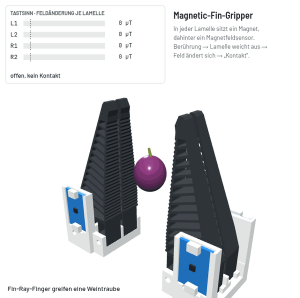

# Magnetic-Fin-Gripper: Zwillings-Fin-Ray mit Magnet-Tastsinn



Zwei Greiferfinger für den Seeed reBot DevArm B601-DM (passen auf dessen Greiferbacken, Lochbild der Seeed-Backe). Jeder Finger hat zwei weiche TPU-Lamellen. In jeder Lamelle sitzt ein kleiner Magnet, dahinter ein Magnetfeldsensor (Adafruit MLX90393). Drückt etwas gegen eine Lamelle, bewegt sich der Magnet, der Sensor merkt das, und der PC zeigt „Kontakt“ an.

```
PC ──USB── Pico (RP2040) ──I2C── Hub ──┬── L1  linker Finger, Lamelle 1
                                       ├── L2  linker Finger, Lamelle 2
                                       ├── R1  rechter Finger, Lamelle 1
                                       └── R2  rechter Finger, Lamelle 2
```

Stand: Basis V1.8.1, Lamellen V1.6-N, Variante W2c als Probe. Pico mit MicroPython v1.29.0.

**Entwickler:** Stefan Rohringer

**Lizenz:** Copyright © 2026 Stefan Rohringer. Hardware (STL, Zeichnungen, Anleitungen) unter CERN-OHL-S-2.0 (`LICENSE-HARDWARE`), Software (`pc/`, `pico/`) unter GPL-3.0 (`LICENSE`). Wer etwas davon verändert und weitergibt, muss seine Fassung unter derselben Lizenz offenlegen.

## Inhalt

1. [Schnellstart](#1-schnellstart)
2. [Was ist was (Ordner)](#2-was-ist-was)
3. [Software: alle Programme und wie man sie startet](#3-software)
4. [Hardware anschließen](#4-hardware-anschließen)
5. [Magnete: welcher Pol wohin](#5-magnete-welcher-pol-wohin)
6. [Test, Schritt für Schritt](#6-test-schritt-für-schritt)
7. [Wenn etwas nicht geht](#7-wenn-etwas-nicht-geht)
8. [Drucken und Zusammenbau](#8-drucken-und-zusammenbau)

---

## 1. Schnellstart

Alles im Terminal im Projektordner:

```bash
cd Greifer   # Ordner dieses Repos

pc/monitor.sh                  # Live-Fenster mit Diagramm (das wichtigste Programm)
pc/monitor.sh greifer_XYZ.csv  # eine Aufnahme auswerten
pc/start.sh                    # nur Text im Terminal + sofort CSV-Aufnahme (Ende: Strg+C)
pc/pico_aufspielen.sh          # pico/main.py auf den Pico spielen (nach Änderungen)
ansicht/greifer_3d.html        # 3D-Ansicht: im Browser öffnen (Doppelklick)
```

Vorher: Sensoren anschließen, **dann** USB einstecken (Abschnitt 4). Es kann immer nur **ein** Programm gleichzeitig mit dem Pico reden. Thonny, `start.sh` und `monitor.sh` also nicht zusammen laufen lassen.

Voraussetzung unter Linux: `sudo apt install python3-venv python3-tk` (für die virtuelle Umgebung und das Monitor-Fenster).

Beim allerersten Start legen die Skripte eine eigene Python-Umgebung an. Das dauert einmalig etwa eine Minute (Abschnitt 3.1).

---

## 2. Was ist was

| Ordner / Datei | Wofür |
|---|---|
| `README.md` | Kurzfassung auf Englisch |
| `README.de.md` | diese Anleitung |
| **druck/** | |
| `druck/Basis_V1.8.1_PLA.stl` | Basis V1.8.1, liegt schon richtig (Platte unten), 2 × drucken |
| `druck/Lamellen_V1.6N_TPU_2Stueck.stl` | Zwillings-Fin-Ray-Lamellen V1.6-N, zwei Stück (eine linke, eine rechte), Innenseite unten |
| `druck/W2c_Lamelle_TPU_2Stueck.stl`, `druck/W2c_Nagel_PLA_2Stueck.stl` | Variante W2c: dieselbe Lamelle mit Zapfen und PLA-Fingernagel für sehr kleine Teile |
| `druck/ANLEITUNG_W2c.md` | Druck, Zusammenbau und Test der Variante W2c |
| `ansicht/greifer_3d.html` | 3D-Ansicht: im Browser öffnen (braucht Internet für die 3D-Bibliothek). Vorführung, Sensoranzeige je Lamelle, Greiferweite, Spalt, Fin-Ray oder W2c, Traube oder SMD-Teil |
| **zeichnungen/** | |
| `zeichnungen/Massblatt_V1.8.1.pdf` | Maßblatt Basis V1.8.1: Schnitte, Lochbild, geänderte Maße (auch als PNG) |
| `zeichnungen/Massblatt_Lamelle_V1.6N.pdf` | Maßblatt Fin-Ray-Lamelle V1.6-N: Profil, Federn, Magnettasche (auch als PNG) |
| `zeichnungen/Massblatt_W2c_Fingernagel.pdf` | Maßblatt W2c: Nagel, Zapfen, Sitz auf den Lamellen (auch als PNG) |
| **Anschluss und Löten** | |
| `anschlussplan.svg` | Anschlussplan als Bild; `ANSCHLUSSPLAN.html` dasselbe mit Erklärungen, im Browser öffnen |
| `zeichnungen/Loetbruecken_A0_A1.png` | wo die Lötbrücken A0/A1 sitzen und wie man sie schließt (die Adressen in der Tabelle im Bild sind veraltet, richtig sind die in Abschnitt 4.1) |
| **pico/** | |
| `pico/main.py` | Programm für den Pico: liest die Sensoren etwa 50-mal pro Sekunde und schickt die Werte über USB |
| `pico/kontakt.py` | Kontakterkennung (Abschnitt 3.7); läuft auf dem Pico und in der PC-Auswertung |
| **pc/** | |
| `pc/monitor.sh` → `greifer_monitor.py` | Greifer-Monitor: Live-Diagramm, Aufnahme, Pol-Anzeige, CSV-Auswertung |
| `pc/start.sh` → `greifer_lesen.py` | Werte als Text im Terminal, zeichnet sofort als CSV auf |
| `pc/pico_aufspielen.sh` | spielt `pico/main.py` und `pico/kontakt.py` auf den Pico |
| `pc/kontakt_vergleich.py` | Kontakterkennung an Aufnahmen vergleichen, Druckrichtung je Sensor messen (Abschnitt 3.7) |
| `pc/_venv.sh`, `pc/requirements.txt` | Einrichtung der Python-Umgebung (wird von den Skripten benutzt, nicht direkt starten) |
| **messungen/** | entsteht beim ersten Aufzeichnen; die CSV-Dateien sind nicht in Git |

---

## 3. Software

### 3.1 Python-Umgebung (automatisch)

Die drei `.sh`-Skripte in `pc/` benutzen eine **eigene virtuelle Umgebung** `.venv` im Projektordner. Darin liegen pyserial, mpremote und matplotlib (Liste: `pc/requirements.txt`).

- Wird beim ersten Start automatisch angelegt und nachinstalliert, wenn sich `requirements.txt` ändert.
- System-Python, conda (`base`) und ROS werden **nicht** verändert. Kein sudo nötig.
- Ein gesetzter `PYTHONPATH` (z. B. aus einem ROS-Workspace) wird nur für diese Skripte ausgeblendet, damit sich nichts in die Quere kommt. Im Terminal bleibt er gesetzt.
- Kaputt? Ordner `.venv` löschen, beim nächsten Start entsteht er neu.
- VS Code: Für Code-Hinweise unten rechts bzw. „Python: Select Interpreter“ → `.venv/bin/python` im Repo-Ordner wählen.

Für den Zugriff auf den Pico ohne Root muss der Benutzer in der Gruppe `dialout` sein (einmalig `sudo usermod -aG dialout $USER`, danach neu anmelden).

### 3.2 Greifer-Monitor: `pc/monitor.sh`

```bash
pc/monitor.sh                       # live vom Pico
pc/monitor.sh --port /dev/ttyACM1   # falls der Pico nicht von selbst gefunden wird
pc/monitor.sh greifer_2026-10-16_194112.csv   # Aufnahme auswerten
```

**Live-Fenster:**
- **oben:** Abweichung |B| vom Nullpunkt je Sensor über die letzten 10 Sekunden (ob Kontakt ist, entscheidet der Pico, siehe 3.7; angezeigt rechts)
- **unten:** x, y, z des Sensors, der rechts unter „Sensor unten“ gewählt ist
- **rechts:** aktueller Wert je Sensor mit „KONTAKT“ oder „SAETTIGUNG!“, Knopf **Nullpunkt** (Finger dabei nicht berühren), Knopf **Aufnahme starten/stoppen**, **Pol-Anzeige** (Abschnitt 5) und die letzten Meldungen vom Pico
- Beenden: Fenster schließen

Beim Start nimmt der Monitor automatisch einen neuen Nullpunkt. Finger in den ersten Sekunden also nicht berühren.

**Auswertung einer Aufnahme:** zeigt Diagramme aller Sensoren und schreibt eine Tabelle ins Terminal:

| Spalte | Bedeutung |
|---|---|
| Rauschen | Zittern von \|B\| von Messung zu Messung ohne Kontakt (langsame Bewegungen zählen nicht mit). Gut: unter 5 µT, gemessen etwa 1 µT |
| Maximum | größte Abweichung |
| Kontakte | wie oft Kontakt erkannt wurde, mit derselben Erkennung wie auf dem Pico neu berechnet (3.7) |
| Kontaktzeit | wie lange insgesamt Kontakt war |

Im Diagramm sind die Kontakte bei jedem Sensor grün hinterlegt.
| stärkste Achse | auf welcher Achse und mit welchem Vorzeichen der Magnet beim Maximum am stärksten wirkt |

### 3.3 Nur Text und Aufnahme: `pc/start.sh`

```bash
pc/start.sh                 # mit neuem Nullpunkt
pc/start.sh --ohne-null     # alten Nullpunkt behalten
pc/start.sh --port /dev/ttyACM1
```

Zeigt fünfmal pro Sekunde eine Zeile wie `L1    283   uT   Kontakt: L1` und schreibt **alle** Messungen (etwa 85 pro Sekunde) nach `messungen/greifer_<Datum>_<Zeit>.csv`. Ende mit Strg+C.

Das Skript sucht den Pico über seine USB-Kennung (Raspberry Pi, 2E8A) und öffnet nie den Anschluss des Arms.

### 3.4 Programm auf den Pico spielen: `pc/pico_aufspielen.sh`

```bash
pc/pico_aufspielen.sh
```

Kopiert `pico/main.py` als `main.py` auf den Pico und startet ihn neu. Ab dann läuft das Programm bei jedem Einstecken von selbst. Nach jeder Änderung an `pico/main.py` wieder ausführen. Vorher Monitor und `start.sh` schließen.

**Pico neu einrichten** (einmal bei einem neuen Pico):
1. MicroPython laden: https://micropython.org/download/RPI_PICO/ , die neueste `.uf2`-Datei.
2. BOOTSEL-Taste am Pico halten, USB einstecken, loslassen. Ein Laufwerk `RPI-RP2` erscheint.
3. Die `.uf2`-Datei auf das Laufwerk ziehen. Der Pico startet neu, das Laufwerk verschwindet.
4. `pc/pico_aufspielen.sh` ausführen.

Alternativ mit Thonny (`sudo apt install thonny`): unten rechts „MicroPython (Raspberry Pi Pico)“ wählen, `pico/main.py` öffnen, „Speichern unter“ → „Raspberry Pi Pico“, Name `main.py`.

### 3.5 Was der Pico schickt

In Thonny oder einem seriellen Terminal sieht man direkt die Ausgabe:

```
# rebot Greifer-Sensorik v1
# I2C gefunden: 0x18 0x19
# FEHLT: R1 (Loetbruecke A1) - Kabel und Loetbruecke pruefen
# OK: L1 (0x18)
# OK: L2 (0x19)
# L1 Ruhefeld: x -31  y 18  z 37 uT  (Betrag 0.1 mT)
K,ms,L1x,L1y,L1z,L1b,L2x,L2y,L2z,L2b,kontakt
D,12345,0,3,-4,4,1,-2,0,2,-
```

- Zeilen mit `#` sind Meldungen, `K,` ist die Kopfzeile, `D,` sind Messwerte.
- Pro Sensor vier Zahlen: Abweichung in x, y, z und der Betrag, in Mikrotesla (µT), bezogen auf den Nullpunkt.
- Ganz hinten steht, welcher Sensor Kontakt meldet (Druck in Druckrichtung über 200 µT, siehe 3.7), sonst ein Strich. `L1!SAETTIGUNG` heißt: Magnet zu nah.

Tasten (in Thonny unten eintippen, dann Enter):

| Taste | Wirkung |
|---|---|
| `n` | neuer Nullpunkt (Finger nicht berühren); danach kommt die Kopfzeile neu |
| `r` | umschalten: Abweichung ↔ Rohwerte (absolutes Feld). Die Kontakterkennung läuft weiter. Der Pico merkt sich das bis zum Neustart |
| `a` | immer auf Abweichung schalten (Monitor und `start.sh` schicken das beim Start automatisch) |
| `s` | umschalten: langsam (5 Zeilen/s) ↔ schnell (etwa 85 Zeilen/s) |
| `k` | Kopfzeile noch einmal senden |
| `f` / `l` | immer schnell / immer langsam (für Programme, die den Zustand nicht kennen) |
| `v` | Firmware-Version melden: `# firmware 2` |

**Schnittstelle für andere Programme** (verbindlich): Zeilen `K,…` (Kopf), `D,…` (Messung), `#…` (Meldung) wie oben, Befehle als einzelne Zeichen. Die Zahl `FIRMWARE` oben in `pico/main.py` steigt, wenn sich daran etwas ändert; der ROS-Knoten fragt sie mit `v` ab und warnt bei einer anderen Version. Firmware 2 (16.10.): Befehle `f`, `l`, `v` neu.

Die Sensoren werden **nur beim Start** des Pico-Programms gesucht. Wer einen Sensor dazusteckt: USB ab, stecken, USB wieder dran.

### 3.6 Einstellungen und Datenformat

**Sensor-Einstellungen** (oben in `pico/main.py`):

| Einstellung | Wert | Bedeutung |
|---|---|---|
| `GAIN_SEL` | 7 | kleinste Verstärkung, damit der Magnet nicht übersteuert |
| `RES` | 2 | Auflösung: x/y 0,601 µT pro Schritt, z 0,968 µT pro Schritt |
| Messbereich | x/y etwa ±19 mT, z etwa ±30 mT | darüber meldet das Programm `!SAETTIGUNG` |
| `NULL_PROBEN` | 50 | Messungen für den Nullpunkt |
| I2C | GP4 (SDA), GP5 (SCL), 100 kHz | robust auch mit 50 cm Kabel über den Hub |
| Messrate | etwa 85/s mit einem, etwa 48/s mit vier Sensoren | die Sensoren werden nacheinander abgefragt |

### 3.7 Kontakterkennung (`pico/kontakt.py`)

**Was der Sensor sieht:** Jeder echte Druck schiebt die Lamelle an den Parallelfedern als Ganzes zurück. Das Feld ändert sich deshalb immer in fast dieselbe Richtung, die **Druckrichtung** des Sensors: bei festem Druck höchstens 24° Abweichung (Aufnahmen 16.10. und 17.10., Greifen, obere und untere Lamelle, Drücken von Hand), bei leichter Berührung 51 bis 59°. Das TPU **kriecht**: Nach dem Loslassen schleicht das Feld über viele Sekunden bis Minuten zurück, nach festem Druck (2000 µT) bleiben anfangs mehrere hundert µT stehen, bei L2 am 17.10. sogar 1200 µT. Die Basis (PLA), die Platinen und die Seeed-Backe fühlen nichts.

Deshalb zählt nur der **Anteil der Änderung in Druckrichtung**. Bewegungen quer oder entgegen dazu sind nie Kontakt:

| Zustand | Was passiert |
|---|---|
| ohne Kontakt | Zwei Basislinien laufen mit dem Feld mit: eine schnelle (2 s) und eine langsame (60 s). Drift wird geschluckt. |
| Kontakt EIN, schnell | Das Feld entfernt sich um mehr als 200 µT von der schnellen Basis, höchstens 70° neben der Druckrichtung, und liegt auch gegen die langsame Basis mindestens 100 µT in Druckrichtung (Gegenprobe: die Rückkehr aus einer Auslenkung in Gegenrichtung ist kein Druck). |
| Kontakt EIN, langsam | Der Anteil in Druckrichtung gegen die langsame Basis steigt über 200 µT (höchstens 70° daneben). So wird auch Druck erkannt, der sich langsam aufbaut (Arm setzt langsam auf, Mensch drückt langsam). |
| im Kontakt | Die Basis bleibt stehen, die Spitze wird gemerkt. **Langes Festhalten bleibt Kontakt.** |
| Kontakt AUS | Der Anteil in Druckrichtung fällt unter 40 % der Spitze (oder unter 100 µT). Fällt das Feld beim Loslassen unter die Basis, ist sofort AUS. Beide Basislinien springen auf den aktuellen Wert. |
| nach dem AUS | 5 s lang folgen beide Basislinien dem Zurückkriechen schnell (0,3 s), damit ein neuer Druck gleich danach erkannt wird. |

**Vorher/nachher** (17.10., `pc/kontakt_vergleich.py`, alt = Erkennung vom 16.10. „schnelle Änderung in jede Richtung“):

| Aufnahme / Fall | vorher | nachher |
|---|---|---|
| 16.10. 22:38: 6 × Greifen, obere, untere Lamellen | 30 Kontakte (L1 9, L2 7, R1 7, R2 7) | dieselben 30, gleiche Sensoren, EIN gleich schnell (Verzug 0,00 s) |
| 16.10. 22:35 | L1 1, L2 1, R1 2, R2 2 | dieselben |
| 17.10. am Arm: L2, R2 | 20 und 19 Kontakte | dieselben, Verzug höchstens 0,02 s |
| 17.10. L1 ab 01:56:20 | **umgekehrt**: ein Abfall 19 s nach dem Loslassen galt als Kontakt, danach meldete L1 Kontakt in den Druckpausen und hing 140 s nach dem Loslassen („L1 Kontakt 424 µT“ in der UI) | Kontakt bei jedem Drücken, nach dem Loslassen aus |
| 17.10. R1 beim Öffnen auf 87 mm (339 µT, 81° neben der Druckrichtung, magnetisch) | Schein-Kontakt 93 s | kein Kontakt |
| 17.10. ganze Sitzung (28 min, Armfahrten bis 65 µT, Greifer 3 bis 87 mm) | Schein-Kontakte: L1-Umkehr, R1 beim Öffnen | keine Schein-Kontakte |
| künstlicher langsamer Druck auf 600 µT, dann loslassen | nie erkannt; das Loslassen galt als Kontakt und blieb hängen | 100 µT/s nach 2 s, 50 µT/s nach 4 s, 20 µT/s nach 11 s, 10 µT/s nach 24 s (bei 207 bis 250 µT); schneller Druck nach 0,1 s wie bisher; nichts hängt |

Der „langsame Druck bis 284 µT ohne Kontakt“ vom 17.10. (01:56) war kein Druck: Gelesen wurde 17 s nach dem Loslassen, das Feld kroch gerade zurück. Ebenso L1 129 µT (01:54) und L2 1271 µT (01:58). „Kein Kontakt“ war dort richtig. Die Werte `ut` sind der Abstand zum Nullpunkt, nicht die Kraft.

**Der Preis:** Druck aus der **Gegenrichtung** (Lamelle von außen oder hinten ausgelenkt, am 17.10. einmal bei L1 mit −1000 µT gesehen) meldet keinen Kontakt mehr.

**Am Arm noch zu prüfen:** Ein **Stoß auf die Lamellenspitze** wurde am 16.10. von Hand erkannt (alte Erkennung); seine Feldrichtung ist nicht aufgezeichnet. Liegt sie mehr als 70° neben der Druckrichtung, erkennt die neue Fassung ihn nicht mehr. Ebenso langsames Drücken und Öffnen auf 87 mm am echten Pico. Die Kraft, ab der ein Kontakt gemeldet wird, und die Zeit bis zur Meldung sind noch nicht gemessen; beides braucht es, bevor der Tastsinn den Arm anhalten darf.

Folge für die Kalibrierung: Die Stärke (Anteil in Druckrichtung) ist gut messbar; *wo* an der Lamelle gedrückt wird, zeigt sich höchstens schwach in der Richtung (Abweichungen von 10 bis 24°).

**Offen:** Nach sehr festem, wiederholtem Drücken kann der Kontakt hängen bleiben, wenn das Kriechen mehr als 40 % der Spitze stehen lässt (R1 am 17.10. um 01:58: 650 µT von 1500 µT; vorher genauso). 50 % statt 40 % löst das, schneidet aber echtes Halten ab (L2 hält beim Greifen am 16.10. bei 55 bis 60 % der Spitze). Braucht eine eigene AUS-Regel, etwa das Kriechen erkennen.

**Druckrichtung neu messen**, wenn ein Magnet neu geklebt oder umgedreht wird (Umdrehen kippt das Vorzeichen von z, Abschnitt 5.1), sonst erkennt die Lamelle nichts mehr: Aufnahme starten, die Lamelle einige Male zügig drücken, dann `.venv/bin/python pc/kontakt_vergleich.py --richtung messungen/<datei>.csv` und die ausgegebene Zeile in `DRUCKRICHTUNG` oben in `pico/kontakt.py` eintragen.

**Einstellen:** Die Werte stehen oben in `pico/kontakt.py` (`EIN_UT`, `LANGSAM_UT`, `GEGENPROBE_UT`, `WINKEL_EIN`, `AUS_UT`, `AUS_ANTEIL`, `TAU_S`, `TAU_L_S`, `MERKEN_S`, `TAU_ZURUECK_S`, `DRUCKRICHTUNG`). Dieselbe Datei benutzt die PC-Auswertung, beide entscheiden also gleich. Nach einer Änderung `pc/pico_aufspielen.sh` ausführen. Vorher an den Aufnahmen prüfen: `.venv/bin/python pc/kontakt_vergleich.py messungen/*.csv` vergleicht mit der Fassung auf `main` (`--alt <rev>` für eine andere, `--rampe` zusätzlich mit künstlichem langsamem Druck); `pc/monitor.sh <datei>.csv` zeigt die Kontakte im Diagramm.

Die Erkennung arbeitet auf dem absoluten Feld und ist deshalb unabhängig vom Nullpunkt und vom Rohwert-Modus.

Hinweis: Die Spalten `L1b` usw. in der CSV sind weiter der Abstand zum **Nullpunkt**. Sie können nach dem Loslassen lange über 200 µT bleiben, ohne dass Kontakt ist; maßgeblich ist die Spalte `kontakt`.

**CSV-Datei** (von Monitor und `start.sh`), eine Zeile pro Messung:

| Spalte | Inhalt |
|---|---|
| `pc_zeit` | Uhrzeit am PC (Sekunden seit 1970) |
| `ms` | Zeit im Pico in Millisekunden |
| `L1x`, `L1y`, `L1z` | Abweichung vom Nullpunkt je Achse in µT |
| `L1b` | Betrag der Abweichung in µT |
| … | dasselbe für L2, R1, R2 (nur angeschlossene Sensoren) |
| `kontakt` | welche Sensoren Kontakt melden, sonst `-` |

Die Datei lässt sich auch in LibreOffice Calc öffnen (Trennzeichen Komma).

---

## 4. Hardware anschließen

Bild: `anschlussplan.svg`, ausführlicher `ANSCHLUSSPLAN.html`.

**Erst alles ohne Strom stecken, dann USB einstecken.** Rot an 3V3, nie an VBUS (Pin 40, 5 V).

### 4.1 Adressen und Lötbrücken

Jeder Sensor braucht eine eigene Adresse. Die wird mit zwei Lötbrücken (A0, A1) auf der Rückseite der Platine eingestellt.

| Name | Ort | Lötbrücke | Adresse |
|---|---|---|---|
| L1 | linker Finger, Lamelle 1 | keine | 0x18 |
| L2 | linker Finger, Lamelle 2 | A0 | 0x19 |
| R1 | rechter Finger, Lamelle 1 | A1 | 0x1A |
| R2 | rechter Finger, Lamelle 2 | A0 und A1 | 0x1B |

Die gelieferten Platinen melden sich ohne Brücke auf **0x18** (getestet am 16.10.), nicht auf 0x0C wie im Adafruit-Text. Das ist eine andere Chipvariante. `pico/main.py` erkennt beide (0x0C–0x0F und 0x18–0x1B) und vergibt den Namen nur nach den Lötbrücken.

Schreib den Namen mit Edding auf jede Platine.

**So setzt du eine Lötbrücke** (Bild: `zeichnungen/Loetbruecken_A0_A1.png`):
1. Platine umdrehen. Auf der glatten Rückseite, nahe bei einem der beiden Stecker, sind zwei kleine Lötstellen nebeneinander, darunter steht „A0“ und „A1“. Jede besteht aus zwei Kupferflächen mit einem schmalen Spalt.
2. Lötkolben (etwa 320 °C) gleichzeitig auf beide Flächen, 1 bis 2 Sekunden, etwas Lötzinn dazu, Spitze weg.
3. Ein kleiner glänzender Buckel muss den Spalt überdecken. Zu viel Zinn: Entlötlitze drauf und erhitzen.
4. A0 und A1 **nicht** miteinander verbinden.
5. Kontrolle: Beim Start steht z. B. `# OK: L2 (0x19)`. Steht dort `FEHLT` oder `DOPPELT`, stimmt die Brücke nicht.

Der Buckel hat im Fach Platz, dafür ist die Senkung hinter der Platine (V1.7).

### 4.2 Kabel

| Von | Nach | Kabel |
|---|---|---|
| PC | Pico | USB-Datenkabel (kein reines Ladekabel), eigene USB-Buchse am PC, **nicht** am Hub des Arms |
| Pico Pin 36 (3V3 OUT) | Hub, rote Ader | Adapterkabel 15 cm, weibliche Kontakte |
| Pico Pin 38 (GND) | Hub, schwarze Ader | dasselbe Adapterkabel |
| Pico Pin 6 (GP4, SDA) | Hub, blaue Ader | dasselbe Adapterkabel |
| Pico Pin 7 (GP5, SCL) | Hub, gelbe Ader | dasselbe Adapterkabel |
| Hub | L1, L2, R1, R2 | je 1 Kabel Stecker–Stecker, am **oberen** Stecker der Platine |

Pin-Zählung am Pico: USB-Buchse oben, Pin 1 ist oben links. Links zählt es nach unten 1 bis 20, rechts von unten nach oben 21 bis 40. Pin 36 und 38 sind also rechts oben, Pin 6 und 7 links oben.

Kabellängen am Arm: 20-cm-Kabel für den Finger näher am Hub, 30 und 50 cm für den anderen. Für den Tischtest reichen die 10-cm-Kabel.

**Warum jeder Sensor ein eigenes Kabel hat:** Die Platine steht hochkant im Fach und liegt unten auf. Nur der obere Stecker ist erreichbar, Sensor-zu-Sensor-Kabel gehen also nicht. Elektrisch ist der Stern dasselbe, und ein Wackler betrifft nur einen Sensor.

**Pico und Hub sitzen zusammen am Handgelenk** (Kabelbinder oder Klebepad), weil das Adapterkabel nur 15 cm lang ist. Nur das USB-Kabel läuft am Arm entlang zum PC. Lange Sensorkabel sind störanfällig, USB nicht.

---

## 5. Magnete: welcher Pol wohin

Die Magnete: Delaga 4 × 2 mm, Neodym N35, scheibenförmig. Sie sind **durch die flache Seite** magnetisiert: Eine flache Seite ist Nord, die andere Süd. Von außen sieht man das nicht.

### 5.1 Ist es egal, wie der Magnet zum Sensor steht?

**Für „Kontakt ja/nein“: ja.** Das Programm wertet den Betrag der Änderung aus. Welcher Pol zum Chip zeigt oder ob der Magnet schräg steht, ist dafür egal. Wird der Magnet umgedreht, drehen sich nur die Vorzeichen von x, y und z um.

**Im fertigen Finger: nein**, aus drei Gründen:

1. **Flache Seite zum Chip.** Dann landet das Feld vor allem auf der z-Achse des Sensors, und die verträgt etwa 30 mT. Die x- und y-Achse vertragen nur etwa 19 mT. Im Finger kommen etwa 17 mT an. Läge der Magnet auf der Kante, wäre das knapp an der Grenze. Die Tasche in der Lamelle gibt die richtige Lage vor, wenn der Magnet flach drinliegt.
2. **Alle gleich herum.** Dann zeigen alle vier Sensoren gleiche Vorzeichen. Das braucht die Kalibrierung, besonders für die Kontakthöhe (Test-Schritt 3: Verhältnis zweier Achsen). Außerdem stört jeder Magnet seinen Nachbarsensor im selben Finger dann auf dieselbe, vorhersehbare Weise.
3. **Abstand.** Nicht näher als etwa 4 mm an den Chip, sonst läuft der Sensor in die Sättigung (`!SAETTIGUNG`). Im Finger sind es 5,4 mm, da passiert das nicht. Bei Handtests schon.

### 5.2 Gleich herum markieren (ohne Kompass)

Wo Nord ist, muss man **nicht** wissen. Wichtig ist nur, dass alle vier gleich herum eingeklebt werden.

1. **Stapeln:** Alle Magnete zu einer Säule zusammenschnappen lassen. Sie richten sich dabei von selbst gleich aus.
2. **Markieren:** Die Oberseite des obersten Magneten mit Edding markieren, ihn abnehmen und beiseitelegen. Weiter mit dem nächsten oben, bis alle markiert sind. Alle Markierungen sind dann derselbe Pol.

   Achtung, häufige Verwechslung: Wo zwei Magnete zusammenhalten, berühren sich **immer ein Nord- und ein Südpol** (ungleiche Pole ziehen sich an). Die Kontaktflächen sind also nicht „beide Süd“. Im Stapel hat jeder Magnet oben denselben Pol:

   ```
      oben  ← markieren (N oder S, egal welcher – bei allen derselbe)
    ┌─────┐
    │  N  │  Magnet 1
    │  S  │
    ├─────┤  ← hier berühren sich S und N
    │  N  │  Magnet 2
    │  S  │
    └─────┘
   ```

   Ob die Markierung Nord oder Süd ist, verrät das Zusammenschnappen nicht. Das ist auch nicht nötig. Wer es trotzdem wissen will: Abschnitt 5.4.
3. **Einkleben:** Mit einem Tropfen Kleber in die Tasche der Lamelle, **markierte Seite nach außen**, also zur Seitenwand und Platine hin. Für die Software ist das gleichwertig mit „Nordpol nach außen“ aus dem alten Plan: Hauptsache, alle gleich.

Vorsicht: Neodym-Magnete schnappen hart zusammen und können dabei splittern. Nicht zwischen Finger kommen lassen, von Handy, Bankkarten und Uhren fernhalten.

### 5.3 Prüfen mit dem Monitor (optional, vor dem Kleben)

1. `pc/monitor.sh` starten, rechts unter „Sensor unten“ den Sensor wählen.
2. Magnet mit der markierten Seite **an die glatte Rückseite** der Platine halten (so wie später im Finger), Abstand etwa 5 mm.
3. Rechts steht z. B. „L1 Pol: z MINUS (-5.2 mT)“. Bei jedem Magneten muss dasselbe stehen. Steht einmal PLUS, ist die Markierung auf der falschen Seite.

Immer von derselben Seite der Platine messen: Von vorne (Bauteilseite) gemessen dreht sich das Vorzeichen um. Unter etwa 1 mT zeigt die Anzeige „Magnet näher ran“.

### 5.4 Den echten Nordpol finden (falls gewünscht)

- **Kompass:** Die Nordspitze der Nadel (meist rot) wird vom **Südpol** des Magneten angezogen. Die Seite, die die rote Spitze anzieht, ist also Süd.
- Der Handy-Kompass geht auch, ist aber ungenauer; Magnet nicht direkt aufs Handy legen.

### 5.5 Was man beim Handtest sieht

Beispiel mit L1 und einem Magneten von Hand:
- ohne Magnet: 0 bis 6 µT (Rauschen)
- Magnet langsam heran: 30, 70, dann über 200 µT → „Kontakt: L1“
- näher: 300 bis 1 500 µT
- Magnet weg: zurück auf etwa 10 µT

Das passt: Der Sensor reagiert deutlich, schon bevor der Magnet nah ist. Die Schwelle von 200 µT wird sicher überschritten, und es kommt keine Sättigung. Im fertigen Finger ändert sich das Feld beim festen Drücken um 1,6 bis 2,2 mT (gemessen), also weit über der Schwelle.

---

## 6. Test, Schritt für Schritt

Am besten mit `pc/monitor.sh` und Aufnahme-Knopf.

1. **Ein Sensor, ein Magnet, ohne Finger:** L1 anschließen, Magnet mit der Hand langsam an den Chip heranführen. Der Betrag muss deutlich steigen, über 200 µT erscheint „Kontakt“. Erfahrungswert: Rauschen etwa 1 µT, Magnet von Hand bis 1,5 mT.
2. **Finger auf dem Tisch:** Lamelle mit Magnet in die Basis, Platine ins Fach, Nullpunkt nehmen. Mit dem Daumen bis zum Anschlag drücken. **Bestanden, wenn** sich eine Achse um mehrere hundert µT ändert und beim Loslassen auf etwa 0 zurückgeht.
3. **Spitze gegen Basis drücken:** Eine zweite Achse soll sich dabei anders verhalten. Das ist das Signal für die Kontakthöhe.
4. **Alle vier:** Nacheinander jede Lamelle drücken. Es darf nur der Name dieser Lamelle als Kontakt erscheinen.

Bei Schritt 2 und 3 eine Aufnahme machen und die CSV-Datei aufheben. Daraus wird die Kalibrierung gemacht.

Einordnung: Das ist ein Tischtest, noch ohne Arm.

---

## 7. Wenn etwas nicht geht

| Meldung / Problem | Ursache | Abhilfe |
|---|---|---|
| `Kein Pico gefunden` | Pico nicht eingesteckt, Ladekabel ohne Daten, oder Pico hängt im BOOTSEL-Modus (Laufwerk `RPI-RP2` ist zu sehen, `lsusb` zeigt „RP2 Boot“) | Datenkabel nehmen. Im BOOTSEL-Modus fehlt MicroPython: Abschnitt 3.4 „Pico ganz neu einrichten“ |
| `Mehrere Picos gefunden` | zweiter Pico am PC | `--port /dev/ttyACM0` (oder 1) angeben |
| `could not open port` / Anschluss belegt | Thonny, `start.sh` oder Monitor läuft schon | das andere Programm schließen |
| `FEHLT: L2 …` | Kabel sitzt nicht oder Lötbrücke falsch | Stecker an Hub und Platine prüfen, Ersatzkabel probieren, Brücke prüfen (4.1) |
| `DOPPELT: …` | zwei Platinen mit gleichen Lötbrücken | Brücken prüfen, jede Platine braucht eine andere Kombination |
| `I2C gefunden: nichts` | Adapterkabel Pico–Hub falsch oder lose | Pins 36, 38, 6, 7 prüfen (4.2) |
| Sensor neu angesteckt, wird nicht erkannt | Sensoren werden nur beim Start gesucht | USB ab und wieder dran |
| `!SAETTIGUNG` | Magnet näher als etwa 4 mm am Chip | Magnet weiter weg |
| Alle Werte bei mehreren tausend µT; Auswertung meldet „ROHWERTEN“ | Pico steht im Rohwert-Modus (Taste `r`) | Monitor neu starten (schaltet mit `a` zurück) oder USB ab und wieder dran |
| „Kontakt“ bleibt nach dem Loslassen stehen | alte Firmware mit fester Schwelle | `pc/pico_aufspielen.sh` (spielt `main.py` und `kontakt.py` auf) |
| Leichte Berührung wird nicht erkannt | Änderung unter 200 µT | `EIN_UT` in `pico/kontakt.py` senken (z. B. 120), erst an einer Aufnahme am PC ausprobieren |
| `ImportError: no module named 'kontakt'` in Thonny | `kontakt.py` fehlt auf dem Pico | `pc/pico_aufspielen.sh` |
| Werte driften langsam weg | Temperatur, Magnet in der Nähe verschoben | Nullpunkt neu nehmen (Knopf oder `n`) |
| Monitor-Fenster bleibt leer („Warte auf Pico …“) | Pico-Programm steht (z. B. nach mpremote-Befehlen) | `pc/pico_aufspielen.sh` oder USB ab und wieder dran |
| Python-Fehler beim Start der Skripte | `.venv` kaputt | Ordner `.venv` löschen und neu starten |

---

## 8. Drucken und Zusammenbau

### 8.1 Druckliste für beide Finger

| Datei | Wie oft | Material | Einstellung in Bambu Studio |
|---|---|---|---|
| `druck/Basis_V1.8.1_PLA.stl` | 2 × | PLA+ weiß | Profil „0.20mm Standard @BBL P2S“, 4 Wandlinien, 100 % Füllung, keine Stützen |
| `druck/Lamellen_V1.6N_TPU_2Stueck.stl` | 2 × (gibt 4 Lamellen) | TPU 95A schwarz, externe Spule, vorher trocknen | Profil „0.20mm Standard @BBL P2S“, Filament „Generic TPU“, 4 Wandlinien, 100 % Füllung, keine Stützen |

Variante W2c (Fingernagel für sehr kleine Teile): Druck und Zusammenbau in `druck/ANLEITUNG_W2c.md`.

Reihenfolge: **erst eine Basis** drucken und anprobieren (passt sie auf die Backe, geht die Platine ins Fach, ist seitlich Platz?). Dann die zweite Basis und die Lamellen.

Material: Basis 16,1 cm³, **gewogen 19,5 g** pro Stück (39 g für beide); Lamelle 7,2 cm³, **gewogen 8,5 g** pro Stück (34 g für alle vier). 

### 8.2 Zusammenbau je Finger

1. Basis mit den 4 Seeed-Schrauben auf die Backe schrauben. Die Schrauben gehen von oben durch die großen Zugangslöcher.
2. Magnet mit einem Tropfen Kleber in die Tasche jeder Lamelle (Außenseite, unten an der Nabe). Alle gleich herum, markierte Seite nach außen (Abschnitt 5).
3. Lamellen links und rechts der Mittelwand einsetzen, Magnet zeigt zur Seitenwand.
4. Die 2 Querschrauben durch Wand, Fuß, Mittelwand, Fuß, Wand stecken.
5. Lötbrücken vorher setzen (4.1). Kabel in den oberen Stecker der Platine stecken, dann die Platine von oben in das Fach schieben, **Bauteile und Chip nach außen**, die glatte Rückseite zur Wand. Welche kurze Kante unten ist, ist egal (beide Lagen geprüft). Sie soll mit leichtem Druck bis auf die Auflage rutschen.

Handtest: Mit dem Daumen gegen die Greiffläche drücken. Der Finger soll sich etwa 2 mm nach hinten schieben und dann hart anschlagen.
